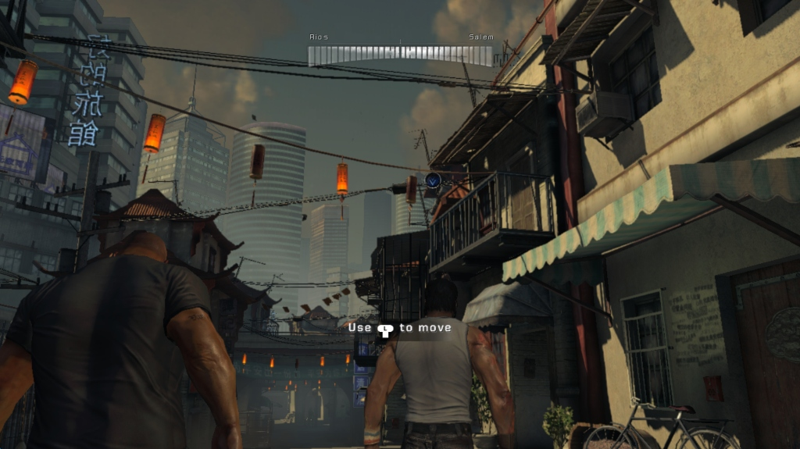
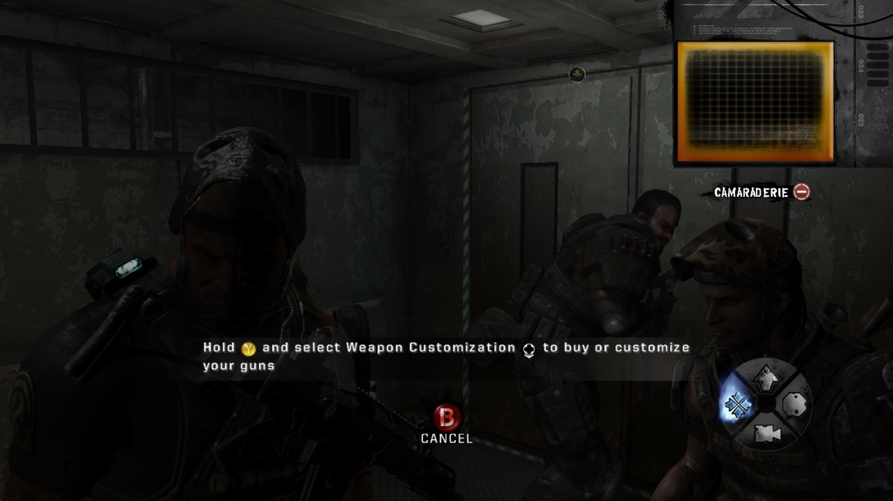
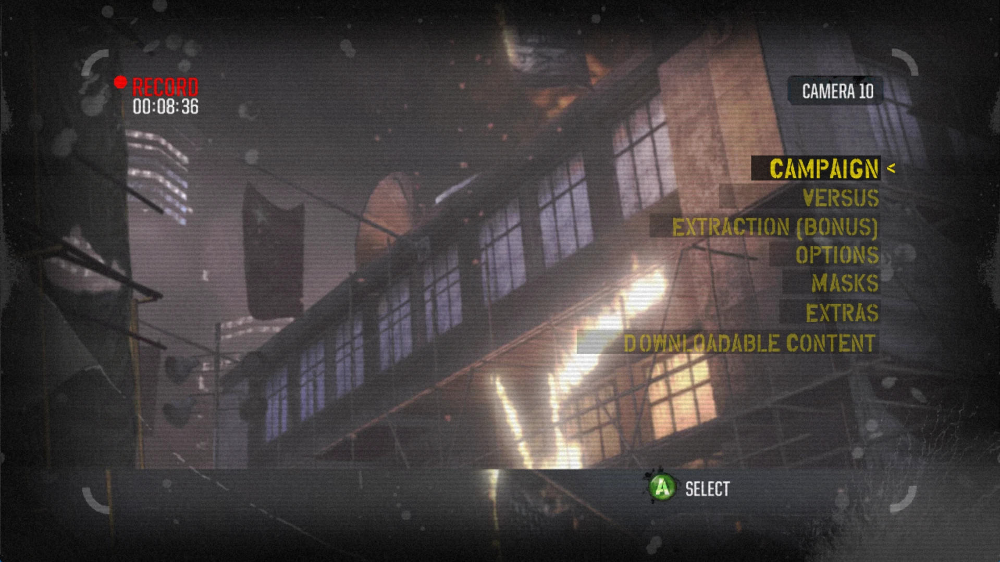
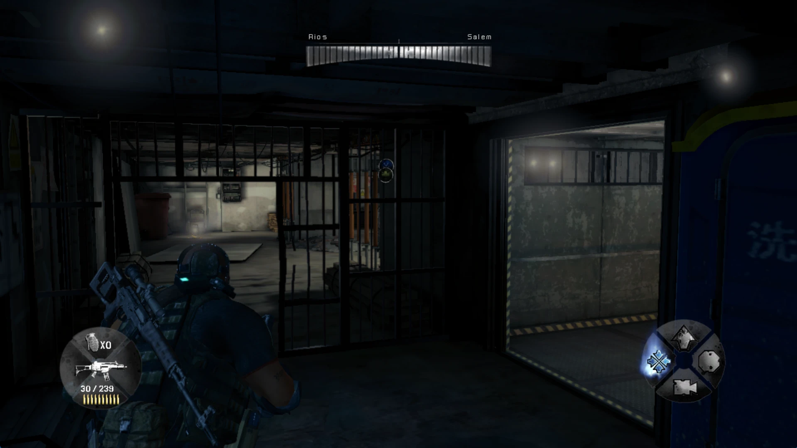

# Army of Two: The 40th Day — рекомпиляция для ПК

Экспериментальный порт Xbox 360-игры **Army of Two: The 40th Day** (2010, Title ID `454108D8`) для Windows x64.

Игра не эмулируется. Код PowerPC из `default.xex` переводится в C++ и собирается в обычный exe на базе [ReXGlue SDK](https://github.com/rexglue/rexglue-sdk).

> В репозитории нет игровых файлов. Нужна своя лицензионная копия диска.

## Текущее состояние (Proof of Concept)

**Работает:**
- заставки, главное меню, выбор сложности и персонажа;
- первая глава (Шанхай): улицы, переулки, лифт, оружейное меню;
- бой в небоскрёбе (Highrise): игра держалась 11 минут подряд;
- геймпад (XInput / SDL3), звук, видеовставки.

**Не работает:**
- пройти игру до конца нельзя: дальше нужны новые функции движка, скрипты боссов и сохранения;
- возможны вылеты на функциях, которые ещё не перекомпилированы (см. раздел «Если что-то падает»).

История запусков и технический разбор — в [docs/DEVLOG.md](docs/DEVLOG.md).

## Скриншоты









## Что нужно

- Windows 10/11 x64 и видеокарта с Direct3D 12.
- Своя копия диска Army of Two: The 40th Day для Xbox 360, распакованная через [extract-xiso](https://github.com/XboxDev/extract-xiso).
- Visual Studio с рабочей нагрузкой «Разработка классических приложений на C++» и компонентом «C++ Clang tools for Windows».
- CMake (входит в Visual Studio).

## Сборка

1. Распакуй диск в папку `assets\`, чтобы внутри были `assets\default.xex` и `assets\AO2Game\`.
2. Создай файл `CMakeUserPresets.json` в корне проекта. Он в `.gitignore`, поэтому его нет в репозитории:

```json
{
    "version": 6,
    "configurePresets": [
        {
            "name": "user-env",
            "hidden": true,
            "cacheVariables": { "CMAKE_PREFIX_PATH": "rexglue/win-amd64" }
        },
        { "name": "local-win-relwithdebinfo", "inherits": ["win-amd64-relwithdebinfo", "user-env"] }
    ]
}
```

3. Открой папку проекта в Visual Studio: **File → Open → Folder**.
4. Выбери конфигурацию `local-win-relwithdebinfo` и нажми **Build → Build All** (F7).

При первой настройке CMake сам скачает ReXGlue SDK и запустит кодогенерацию из `default.xex`. Это занимает несколько минут.

Готовый файл: `out\build\local-win-relwithdebinfo\armyoftwo40threcomp.exe`.

## Настройки

Файлы лежат в `settings\`. Формат — `ключ = значение`, без `[секций]`:

- `hardware.toml` — видеокарта, разрешение (сейчас окно 1920×1080), V-Sync, кэш шейдеров, уровень логов;
- `mapping.toml` — управление.

В `hardware.toml` сейчас стоит `dev_debug_runtime = true`. Это диагностический режим: он перехватывает неизвестные функции, но замедляет игру. Если хочешь играть быстрее, поставь `false`. Тогда неперекомпилированная функция сразу завершит игру.

## Если что-то падает

Типичная ошибка выглядит так: `Call to invalid or unregistered function at guest address 0x…`. Значит, нужная функция ещё не перекомпилирована. Её адрес добавляют в `default_functions.toml`, после чего CMake снова запускает кодогенерацию. Подробности и примеры — в [docs/DEVLOG.md](docs/DEVLOG.md).

## Структура

| Путь | Что там |
|---|---|
| `src/` | Наш код: приложение, исправления, константы |
| `generated/` | Код, созданный ReXGlue. Руками не править, он пересоздаётся |
| `default_functions.toml` | Функции, которые нужно перекомпилировать |
| `armyoftwo40threcomp_manifest.toml` | Манифест кодогенерации |
| `settings/` | Настройки запуска |
| `assets/` | Распакованный диск игры (в git не попадает) |
| `docs/DEVLOG.md` | Полный журнал разработки и технический разбор |
| `army_of_two_recomp_architecture.md` | Архитектура проекта |

## Родственные проекты

- [ArmyOfTwoRecomp](https://github.com/nikolaygorb/ArmyOfTwoRecomp) — рекомпиляция первой части, европейский релиз (автор nikolaygorb).
- [ArmyOfTwoRecomp-USA](https://github.com/crabinacrabic/ArmyOfTwoRecomp-USA) — USA-версия первой части.

## Правовая часть

Army of Two © Electronic Arts / EA Montreal. Проект не связан с EA. Игровые файлы в репозитории не публикуются, для работы нужна лицензионная копия игры.
